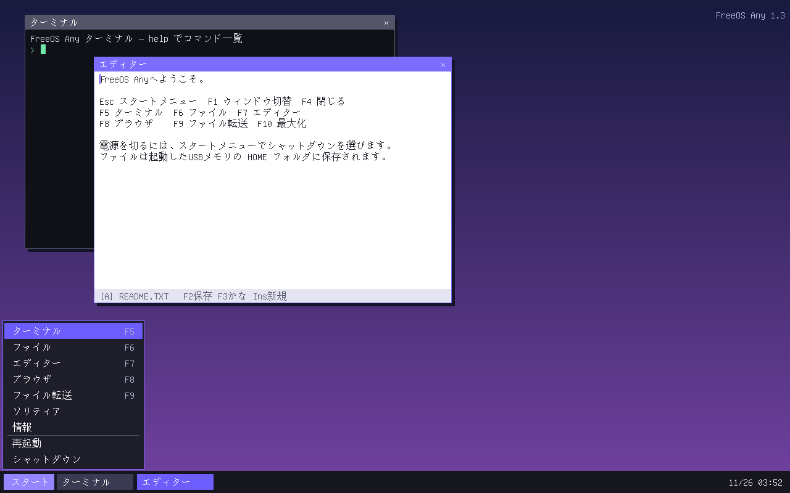

# FreeOS Any 開発の記録

各版のタグ (`git checkout v1.5` など) でその時点のソースを見られます。新しい版が上です。

## v1.3.1 — Mac で開発できるように

- スネークを削除
- Intel Mac の QEMU の仮想化支援 (hvf) で落ちる問題を回避: 仮想 CPU から 1GB ページ機能を隠す (`-cpu host,-pdpe1gb`)。原因は QEMU の hvf が 1GB ページを読めないこと (`vmx_read_mem: mmu_gva_to_gpa failed`)
- macOS の標準ツールでディスクイメージを作る `make image-mac`、すぐ起動して試す `make run-mac`

*スタートメニューからスネークが消えた*

*デスクトップ (hvf で 2〜5 秒で起動)*

## v1.3 — 出発点 (satoru.net/os で公開されていた 1.3)

UEFI の上で動く自作 OS。C 言語、x86-64 / ARM64。公開されていたソース一式をそのまま取り込んだ状態。
- ターミナル、ファイル、エディター (ローマ字かな入力)、ブラウザ (文章とリンクだけ)、ファイル転送、ソリティア、スネーク
- 文字は GNU Unifont (16 ドットの白黒の点)、マウスは仮想マシンのタブレットのみ

*起動直後のデスクトップ*

*スタートメニュー (スネークがある)*

