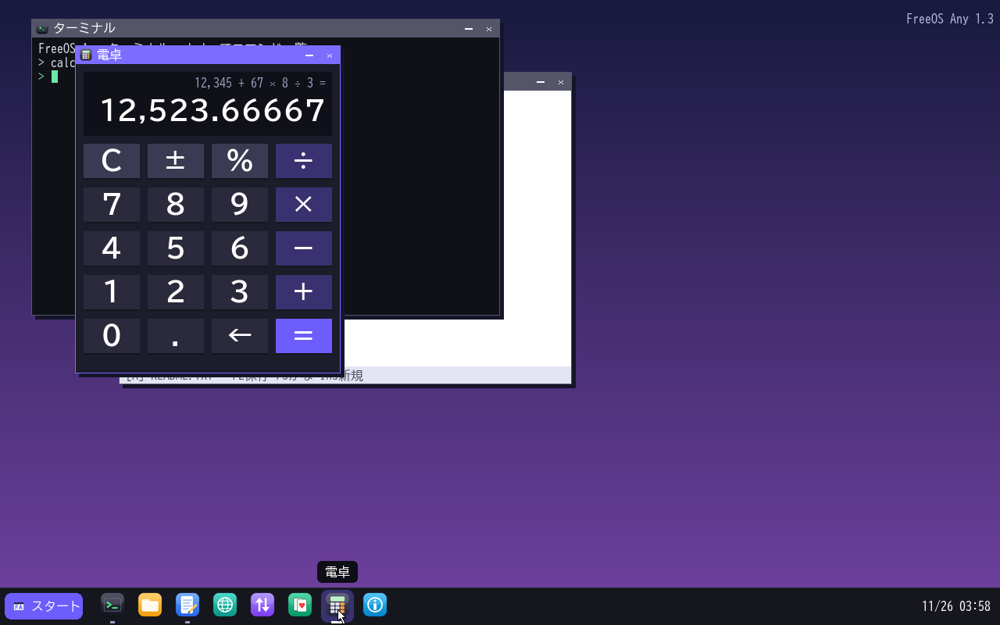
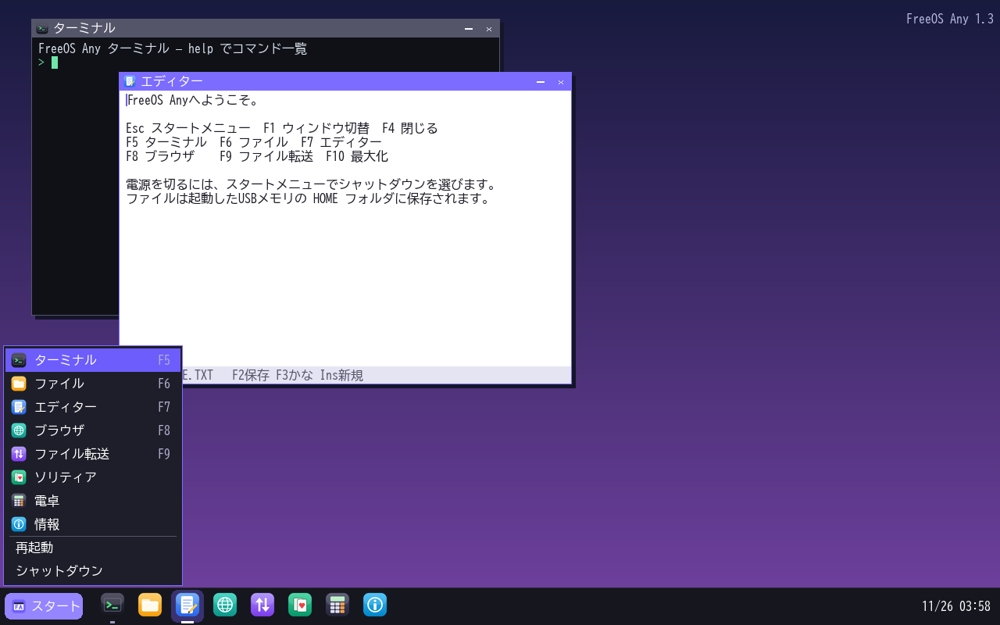
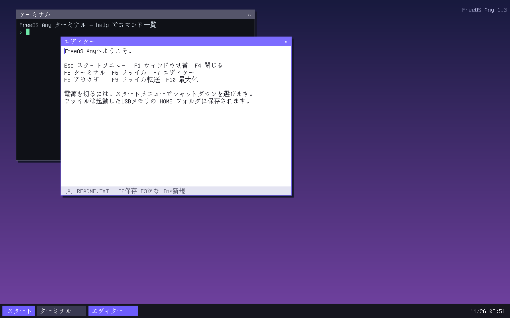

# FreeOS Any 開発の記録

各版のタグ (`git checkout v1.5` など) でその時点のソースを見られます。新しい版が上です。

## v1.7 — アイコンとタスクバー

- 全アプリにアイコン (組み立て時に大きく描いて縮める)
- タスクバーに全アプリのアイコン。起動中は下に印。押すと起動 / 手前へ / 最小化。マウスを乗せると名前
- スタートメニューとタイトルバーにもアイコン。タイトルバーに最小化ボタン

*タスクバー (電卓の上に名前の札)*

*アイコン付きのスタートメニュー*

## v1.6 — 電卓

- かけ算・割り算を先に計算する電卓 (12 + 3 × 2 = 18)。マウスでもキーボードでも使える
- 上に式、下に大きく答え。3 桁ごとのカンマ、入りきらないときは桁を減らす、% と ± も
- ターミナルで `calc` (式なし) でも開く

*12345 + 67 × 8 ÷ 3 =*

## v1.5 — なめらかな文字 (BIZ UDゴシック)

- 画面の文字を BIZ UDゴシック (SIL OFL) に。組み立て時に縦 16 ドットの濃淡付き画像にして埋め込み、背景と混ぜて描く
- 文字幅は今まで通り (半角 8 / 全角 16) なので配置は崩れない。BIZ UDゴシックにない文字は Unifont
- 起動画面の名前は BIZ UDPゴシック Bold の大きな文字

*起動画面の名前も太字に*

*デスクトップ*

*スタートメニュー*

## v1.4.1 — 実機の PC でも起動音 (Intel HD Audio)

- 多くの PC の内蔵音声方式 Intel HD Audio のドライバを追加。端子 (スピーカー / ヘッドホン / ライン出力) から DAC までの道を機種ごとに自動で探してつなぐ
- virtio-sound がなければ HDA で鳴らす。QEMU の HDA 3 種類で確認 (実機は未確認)
- 画面の見た目は v1.4 と同じ

*起動アニメーション (音は HDA で鳴る)*

## v1.4 — 起動アニメーション・起動音・矢印カーソル

- 起動アニメーション (約 2.5 秒): ロゴが弾んで現れ、窓が開き、F と A が書き順どおりに書かれ、光が走り、名前が浮かび、デスクトップへ溶けるように切り替わる。キーで飛ばせる
- 起動チャイム (3 秒): D メジャー add9 の和音を鐘の音で重ねる。OS の中で波形から合成し、仮想マシンの音声装置 (virtio-sound) の自作ドライバで鳴らす
- マウスカーソルを白地に黒い縁の矢印 + 影に

*起動アニメーション*

*デスクトップ*

## v1.3.1 — Mac で開発できるように

- スネークを削除
- Intel Mac の QEMU の仮想化支援 (hvf) で落ちる問題を回避: 仮想 CPU から 1GB ページ機能を隠す (`-cpu host,-pdpe1gb`)。原因は QEMU の hvf が 1GB ページを読めないこと (`vmx_read_mem: mmu_gva_to_gpa failed`)
- macOS の標準ツールでディスクイメージを作る `make image-mac`、すぐ起動して試す `make run-mac`

*スタートメニューからスネークが消えた*

*デスクトップ (hvf で 2〜5 秒で起動)*

## v1.3 — 出発点 (satoru.net/os で公開されていた 1.3)

UEFI の上で動く自作 OS。C 言語、x86-64 / ARM64。公開されていたソース一式をそのまま取り込んだ状態。
- ターミナル、ファイル、エディター (ローマ字かな入力)、ブラウザ (文章とリンクだけ)、ファイル転送、ソリティア、スネーク
- 文字は GNU Unifont (16 ドットの白黒の点)、マウスは仮想マシンのタブレットのみ

*起動直後のデスクトップ*

*スタートメニュー (スネークがある)*

