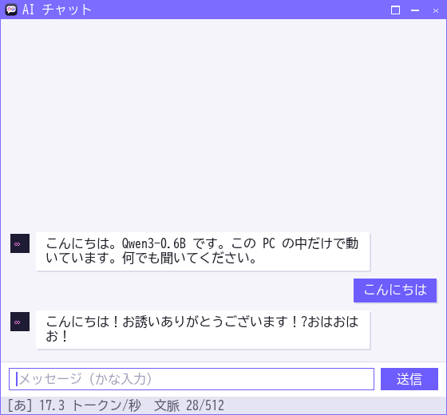
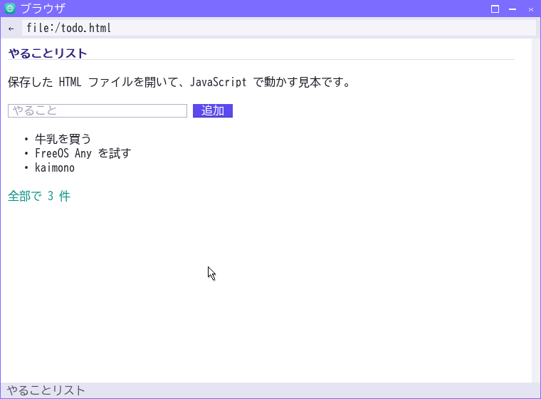
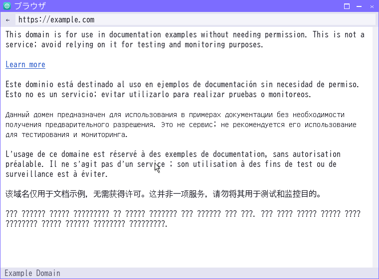
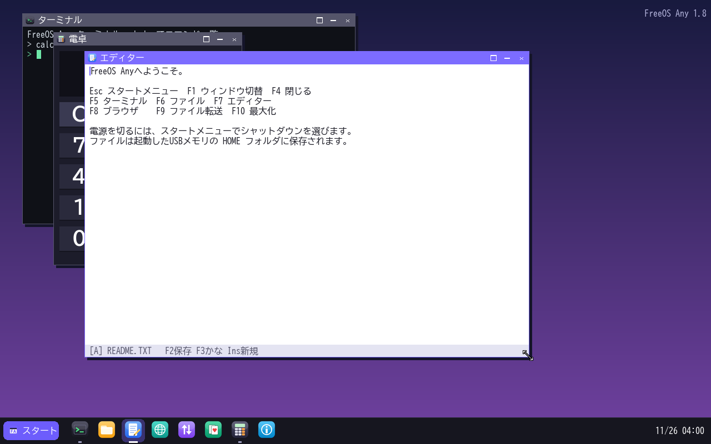
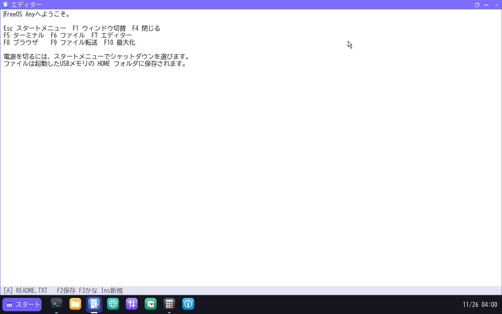
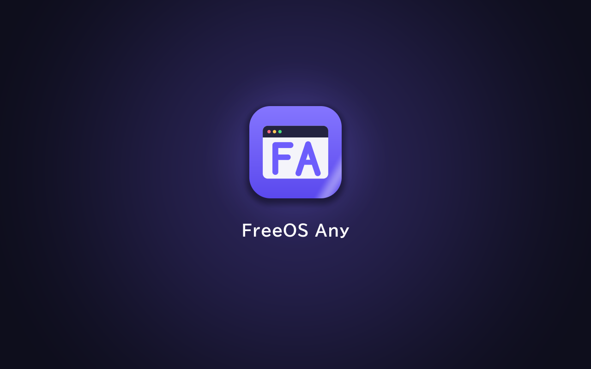
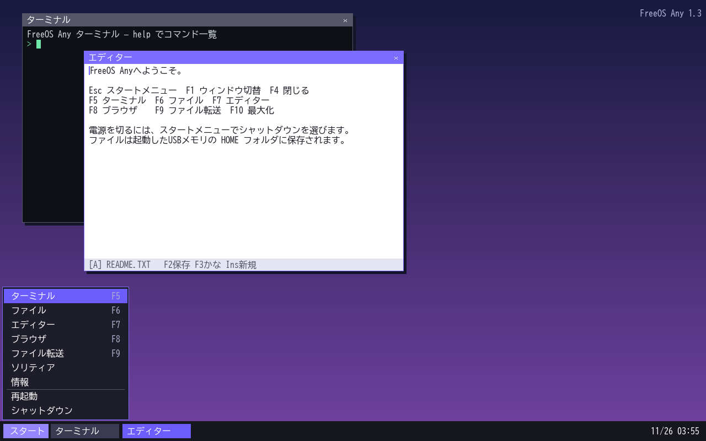
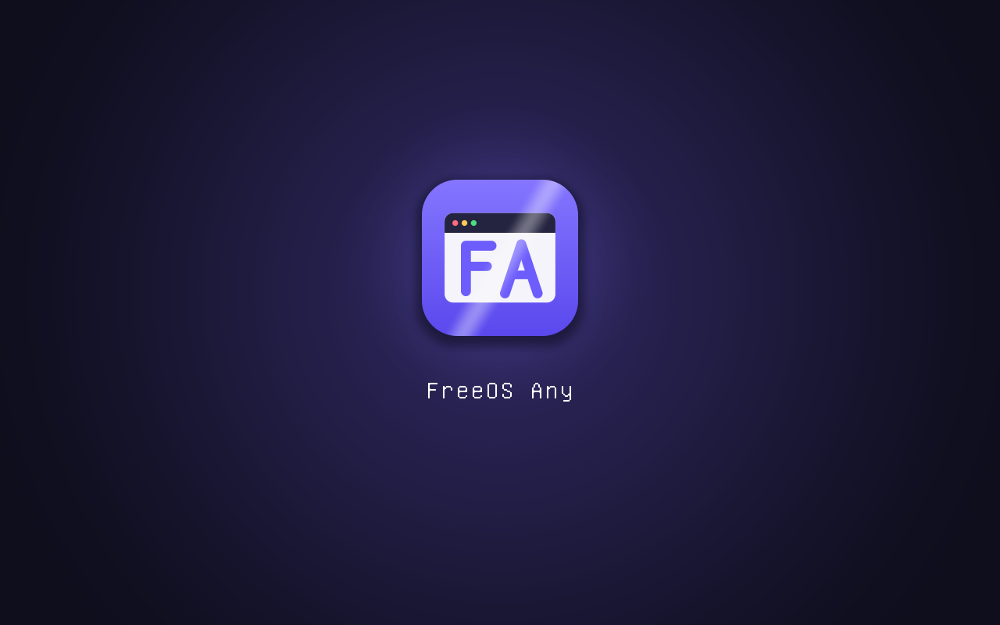
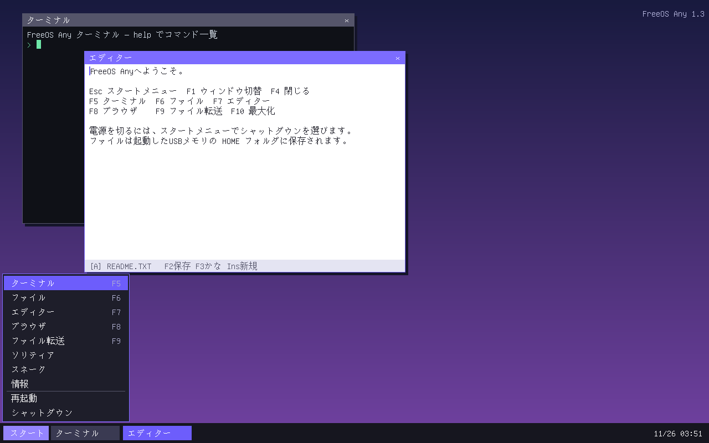

# FreeOS Any 開発の記録

各版のタグ (`git checkout v1.5` など) でその時点のソースを見られます。新しい版が上です。

## v2.1 — AI チャット (Qwen3-0.6B が OS の中で動く)

- Qwen3-0.6B と日本語で会話できる「AI チャット」を追加。OS の中だけで動き、通信しない
- 推論エンジン `src/llm.c` を新しく書いた (llm.asm を参考に C で)。重み 4 ビット・埋め込み 8 ビット、AVX2 で掛け算、トークナイザーは公式と同じ分け方
- モデルの変換 `tools/export_qwen3.py` (NumPy だけ)。モデル約 400MB、メモリ約 600MB
- エディターのローマ字かな入力をチャットでも使えるように。仮想マシンのメモリを 1.5GB に
- このMac (Core i7-5557U) の仮想マシンで 1 秒に約 17 トークン。NumPy で書いた見本の計算と結果が一致することを確認

*ローマ字で「こんにちは」と打って送ると、AI が日本語で返事 (17.3 トークン/秒)*

## v2.0 — HTML と JavaScript のビューアー、スクロール、新しいカーソル

- ブラウザを作り直し: HTML を要素の木 (DOM) にして、見出し・強調・コード・リスト (入れ子)・表・フォーム・リンクをスタイル付きで表示。英語などは単語の切れ目で折り返す
- 小さな JavaScript エンジン (`src/js.c`、OS の中で動く解釈系) を追加。変数・関数・アロー関数・配列・オブジェクト・テンプレート文字列・try/catch・主な組み込み関数
- ページから DOM を操作できる: `getElementById` / `querySelector` / `textContent` / `innerHTML` / `insertAdjacentHTML` / `addEventListener` / `onclick` / `setTimeout` / `setInterval` / `alert` / `console.log` など
- HOME の `.html` をファイルアプリから開けるビューアーに。見本 `todo.html` をディスクに同梱。`about:demo` で見本ページ
- マウスのホイールでスクロール (ホイールのないアプリは矢印キーとして)。ブラウザにスクロールバー
- サイズ変更のカーソルを、なめらかな縁の両矢印 (横・縦・斜め 2 方向、影付き) に
- 文字の範囲を拡大 (ギリシャ文字・キリル文字・矢印・数学記号など)
- `tests/jstest.c` で JavaScript エンジンを Mac / Linux の上で直接試せる

*about:demo — ボタンで数が増え、入力した名前であいさつ、時計はタイマーで動く*

*ファイルアプリから開いた todo.html — JavaScript でリストに追加*

*example.com — ページのスクリプトが各国語の段落を足している*

*サイズ変更のカーソル (横・縦・斜め)*

## v1.9 — 新しいロゴ (∞ と Any)

- ロゴを「FA」から、夜空色の角丸に虹色の ∞ と「Any」に変更 (いつでも・どこでも動く OS)。6 案から選んだ
- 起動アニメーション: 角丸が現れ、∞ が右端から一筆で描かれ、交差点では手前の線が影を落として重なり、Any が浮かび、光が走る
- スタートボタンと Mac アプリ (dmg) のアイコンも同じロゴ。ロゴは `tools/logo.py` で描き、OS の中のアニメーションも同じ形と色

*新しいロゴ*

*起動アニメーション*

*スタートボタンもロゴに*

## v1.8 — ウィンドウのサイズ変更と最大化

- 窓の左・右・下の縁と下の角をドラッグしてサイズ変更。縁ではカーソルが両矢印に
- 最大化ボタン、タイトルバーのダブルクリック、F10 で最大化 / 元に戻す
- 画面の版表示を 1.8 に

*右下の角をドラッグして大きく*

*最大化*

*デスクトップ*

## v1.7 — アイコンとタスクバー

- 全アプリにアイコン (組み立て時に大きく描いて縮める)
- タスクバーに全アプリのアイコン。起動中は下に印。押すと起動 / 手前へ / 最小化。マウスを乗せると名前
- スタートメニューとタイトルバーにもアイコン。タイトルバーに最小化ボタン

*タスクバー (電卓の上に名前の札)*

*アイコン付きのスタートメニュー*

## v1.6 — 電卓

- かけ算・割り算を先に計算する電卓 (12 + 3 × 2 = 18)。マウスでもキーボードでも使える
- 上に式、下に大きく答え。3 桁ごとのカンマ、入りきらないときは桁を減らす、% と ± も
- ターミナルで `calc` (式なし) でも開く

*12345 + 67 × 8 ÷ 3 =*

## v1.5 — なめらかな文字 (BIZ UDゴシック)

- 画面の文字を BIZ UDゴシック (SIL OFL) に。組み立て時に縦 16 ドットの濃淡付き画像にして埋め込み、背景と混ぜて描く
- 文字幅は今まで通り (半角 8 / 全角 16) なので配置は崩れない。BIZ UDゴシックにない文字は Unifont
- 起動画面の名前は BIZ UDPゴシック Bold の大きな文字

*起動画面の名前も太字に*

*デスクトップ*

*スタートメニュー*

## v1.4.1 — 実機の PC でも起動音 (Intel HD Audio)

- 多くの PC の内蔵音声方式 Intel HD Audio のドライバを追加。端子 (スピーカー / ヘッドホン / ライン出力) から DAC までの道を機種ごとに自動で探してつなぐ
- virtio-sound がなければ HDA で鳴らす。QEMU の HDA 3 種類で確認 (実機は未確認)
- 画面の見た目は v1.4 と同じ

*起動アニメーション (音は HDA で鳴る)*

## v1.4 — 起動アニメーション・起動音・矢印カーソル

- 起動アニメーション (約 2.5 秒): ロゴが弾んで現れ、窓が開き、F と A が書き順どおりに書かれ、光が走り、名前が浮かび、デスクトップへ溶けるように切り替わる。キーで飛ばせる
- 起動チャイム (3 秒): D メジャー add9 の和音を鐘の音で重ねる。OS の中で波形から合成し、仮想マシンの音声装置 (virtio-sound) の自作ドライバで鳴らす
- マウスカーソルを白地に黒い縁の矢印 + 影に

*起動アニメーション*

*デスクトップ*

## v1.3.1 — Mac で開発できるように

- スネークを削除
- Intel Mac の QEMU の仮想化支援 (hvf) で落ちる問題を回避: 仮想 CPU から 1GB ページ機能を隠す (`-cpu host,-pdpe1gb`)。原因は QEMU の hvf が 1GB ページを読めないこと (`vmx_read_mem: mmu_gva_to_gpa failed`)
- macOS の標準ツールでディスクイメージを作る `make image-mac`、すぐ起動して試す `make run-mac`

*スタートメニューからスネークが消えた*

*デスクトップ (hvf で 2〜5 秒で起動)*

## v1.3 — 出発点 (satoru.net/os で公開されていた 1.3)

UEFI の上で動く自作 OS。C 言語、x86-64 / ARM64。公開されていたソース一式をそのまま取り込んだ状態。
- ターミナル、ファイル、エディター (ローマ字かな入力)、ブラウザ (文章とリンクだけ)、ファイル転送、ソリティア、スネーク
- 文字は GNU Unifont (16 ドットの白黒の点)、マウスは仮想マシンのタブレットのみ

*起動直後のデスクトップ*

*スタートメニュー (スネークがある)*

