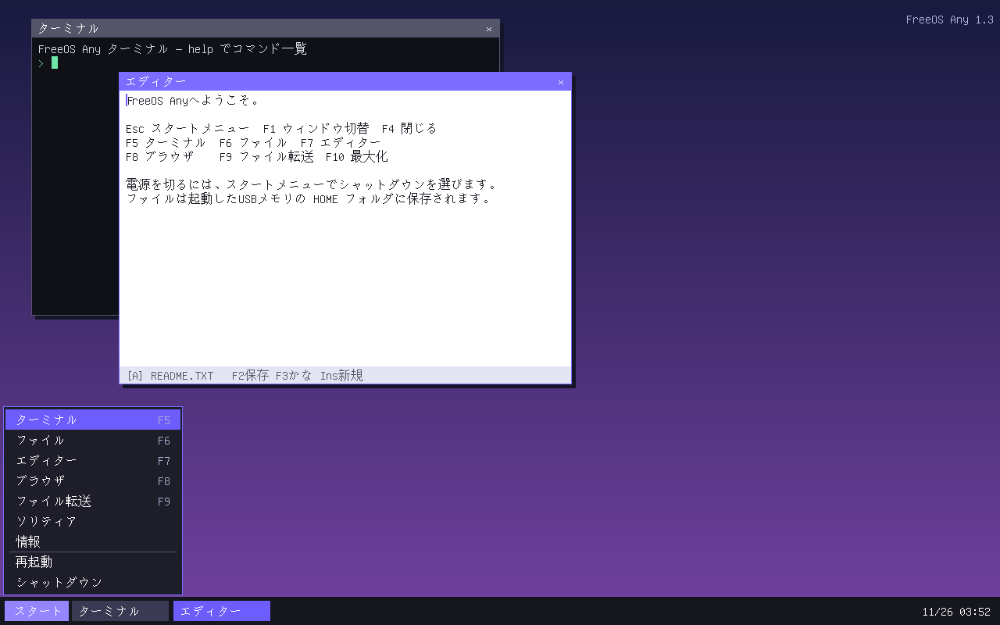
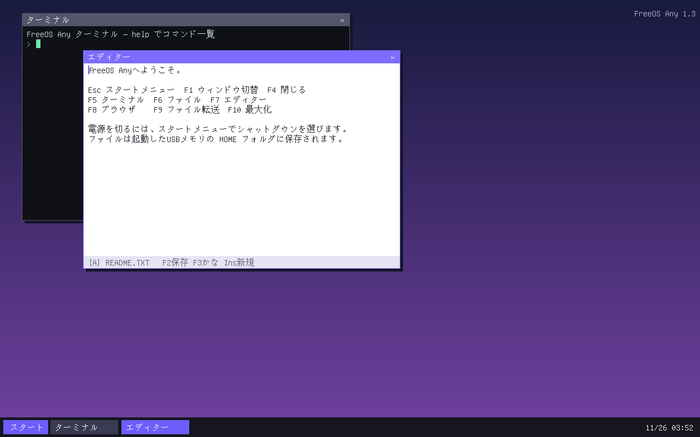

# FreeOS Any v1.3.1 — Mac で開発できるように

[← 開発の記録 (一覧)](../../HISTORY.md)

- スネークを削除
- Intel Mac の QEMU の仮想化支援 (hvf) で落ちる問題を回避: 仮想 CPU から 1GB ページ機能を隠す (`-cpu host,-pdpe1gb`)。原因は QEMU の hvf が 1GB ページを読めないこと (`vmx_read_mem: mmu_gva_to_gpa failed`)
- macOS の標準ツールでディスクイメージを作る `make image-mac`、すぐ起動して試す `make run-mac`

*スタートメニューからスネークが消えた*

*デスクトップ (hvf で 2〜5 秒で起動)*
