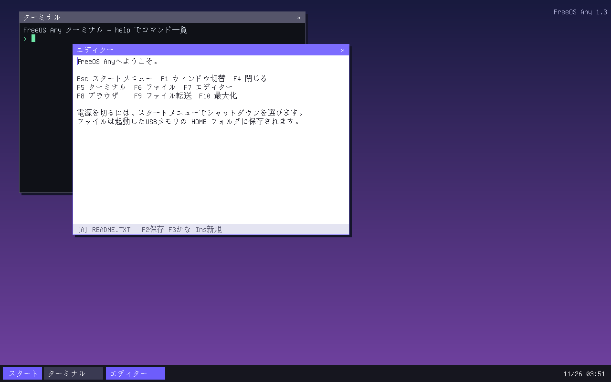
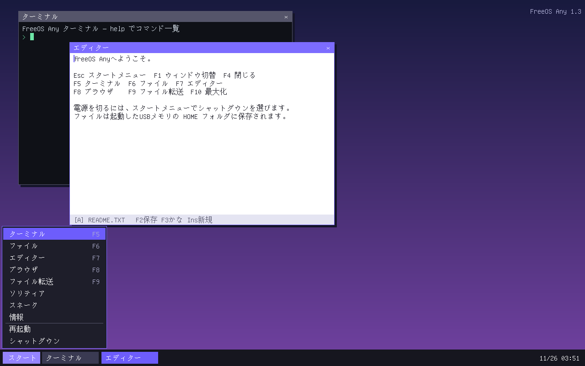

# FreeOS Any v1.3 — 出発点 (satoru.net/os で公開されていた 1.3)

[← 開発の記録 (一覧)](../../HISTORY.md)

UEFI の上で動く自作 OS。C 言語、x86-64 / ARM64。公開されていたソース一式をそのまま取り込んだ状態。
- ターミナル、ファイル、エディター (ローマ字かな入力)、ブラウザ (文章とリンクだけ)、ファイル転送、ソリティア、スネーク
- 文字は GNU Unifont (16 ドットの白黒の点)、マウスは仮想マシンのタブレットのみ

*起動直後のデスクトップ*

*スタートメニュー (スネークがある)*
