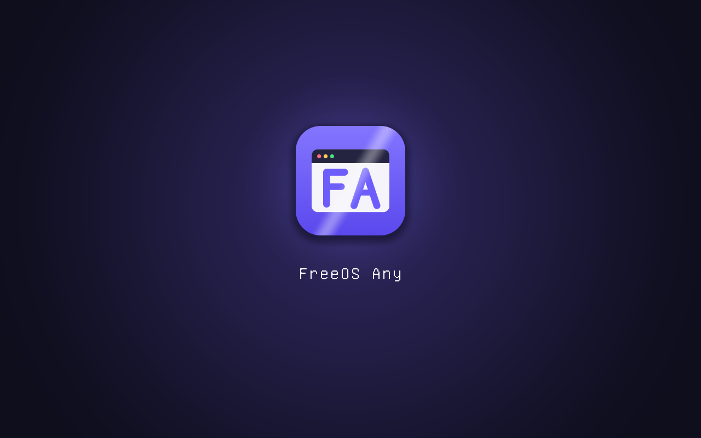

# FreeOS Any v1.4.1 — 実機の PC でも起動音 (Intel HD Audio)

[← 開発の記録 (一覧)](../../HISTORY.md)

- 多くの PC の内蔵音声方式 Intel HD Audio のドライバを追加。端子 (スピーカー / ヘッドホン / ライン出力) から DAC までの道を機種ごとに自動で探してつなぐ
- virtio-sound がなければ HDA で鳴らす。QEMU の HDA 3 種類で確認 (実機は未確認)
- 画面の見た目は v1.4 と同じ

*起動アニメーション (音は HDA で鳴る)*
