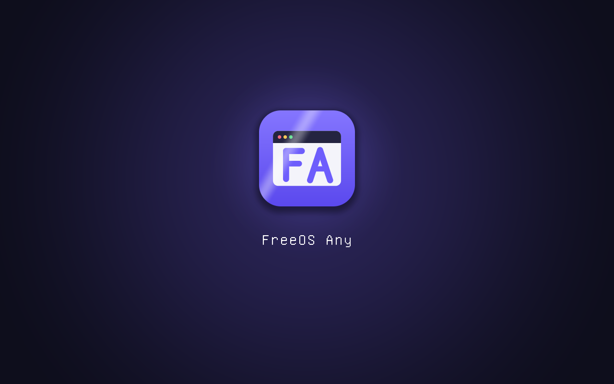
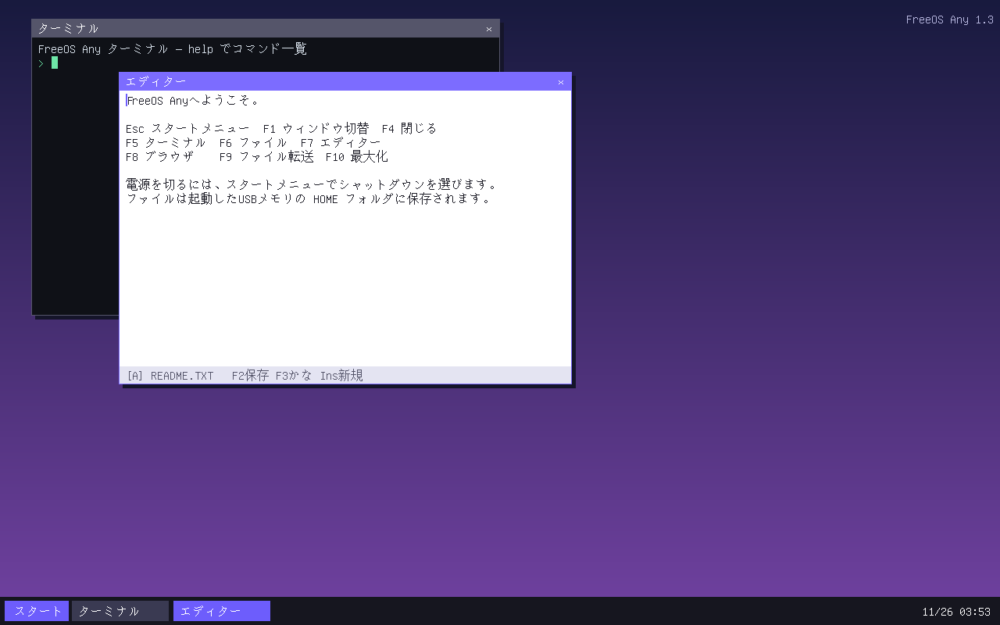

# FreeOS Any v1.4 — 起動アニメーション・起動音・矢印カーソル

[← 開発の記録 (一覧)](../../HISTORY.md)

- 起動アニメーション (約 2.5 秒): ロゴが弾んで現れ、窓が開き、F と A が書き順どおりに書かれ、光が走り、名前が浮かび、デスクトップへ溶けるように切り替わる。キーで飛ばせる
- 起動チャイム (3 秒): D メジャー add9 の和音を鐘の音で重ねる。OS の中で波形から合成し、仮想マシンの音声装置 (virtio-sound) の自作ドライバで鳴らす
- マウスカーソルを白地に黒い縁の矢印 + 影に

*起動アニメーション*

*デスクトップ*
