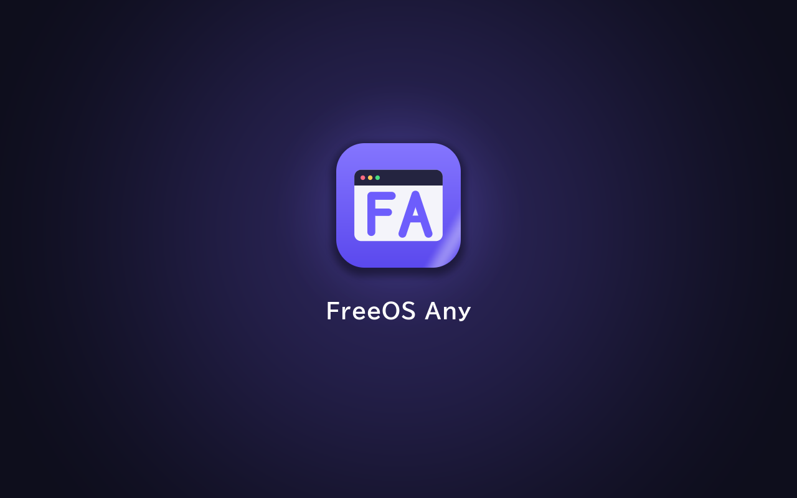
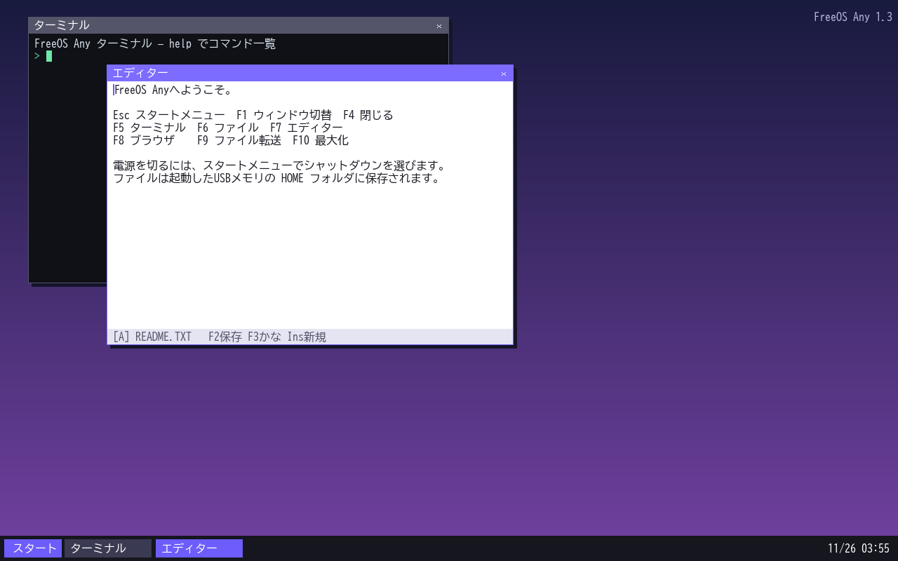
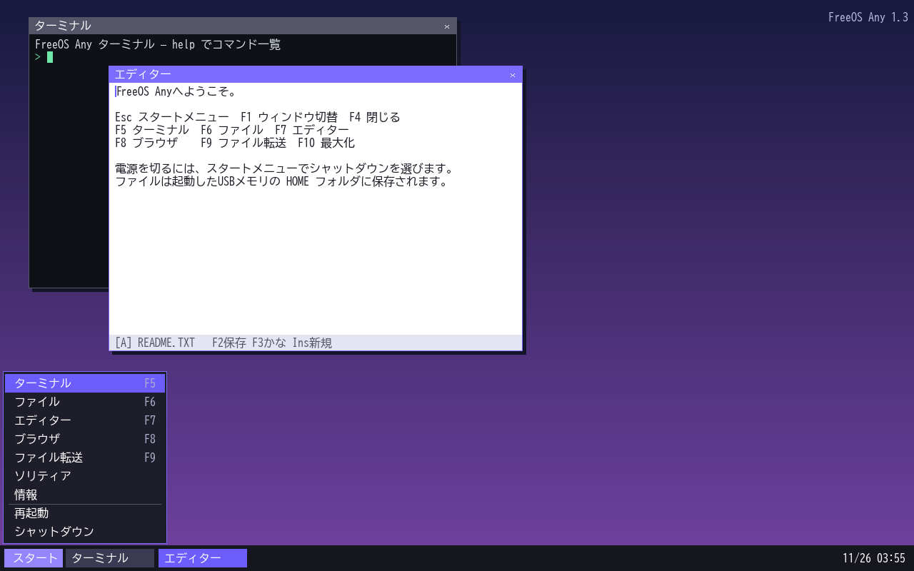

# FreeOS Any v1.5 — なめらかな文字 (BIZ UDゴシック)

[← 開発の記録 (一覧)](../../HISTORY.md)

- 画面の文字を BIZ UDゴシック (SIL OFL) に。組み立て時に縦 16 ドットの濃淡付き画像にして埋め込み、背景と混ぜて描く
- 文字幅は今まで通り (半角 8 / 全角 16) なので配置は崩れない。BIZ UDゴシックにない文字は Unifont
- 起動画面の名前は BIZ UDPゴシック Bold の大きな文字

*起動画面の名前も太字に*

*デスクトップ*

*スタートメニュー*
