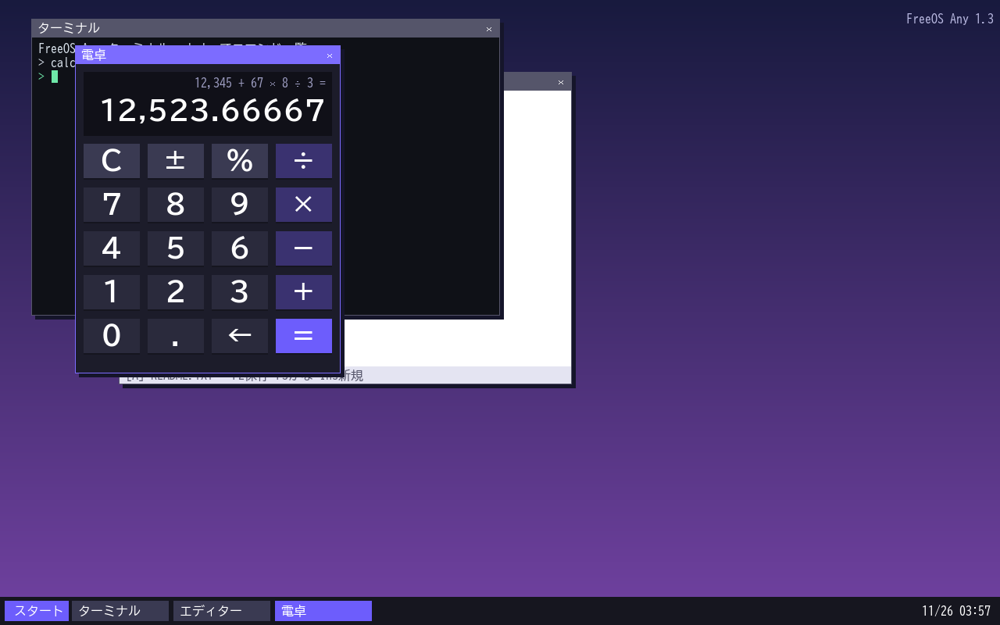

# FreeOS Any v1.6 — 電卓

[← 開発の記録 (一覧)](../../HISTORY.md)

- かけ算・割り算を先に計算する電卓 (12 + 3 × 2 = 18)。マウスでもキーボードでも使える
- 上に式、下に大きく答え。3 桁ごとのカンマ、入りきらないときは桁を減らす、% と ± も
- ターミナルで `calc` (式なし) でも開く

*12345 + 67 × 8 ÷ 3 =*
