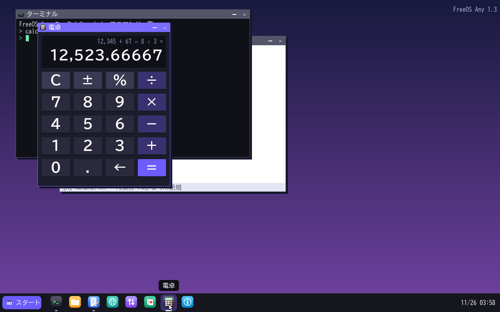
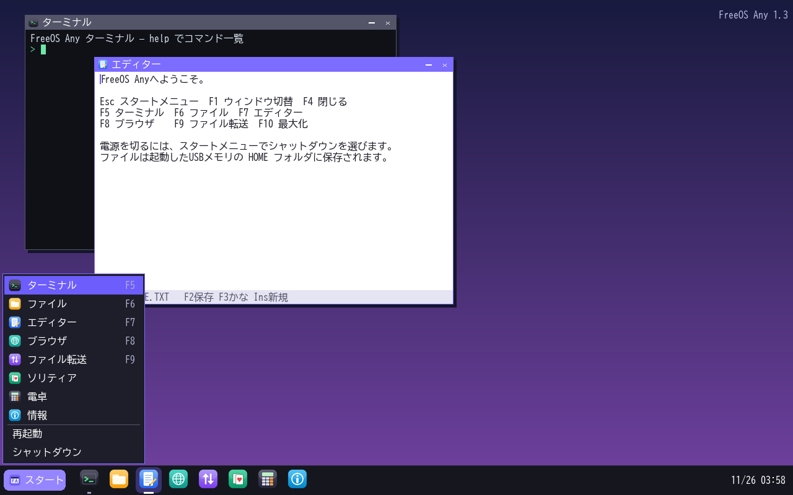

# FreeOS Any v1.7 — アイコンとタスクバー

[← 開発の記録 (一覧)](../../HISTORY.md)

- 全アプリにアイコン (組み立て時に大きく描いて縮める)
- タスクバーに全アプリのアイコン。起動中は下に印。押すと起動 / 手前へ / 最小化。マウスを乗せると名前
- スタートメニューとタイトルバーにもアイコン。タイトルバーに最小化ボタン

*タスクバー (電卓の上に名前の札)*

*アイコン付きのスタートメニュー*
