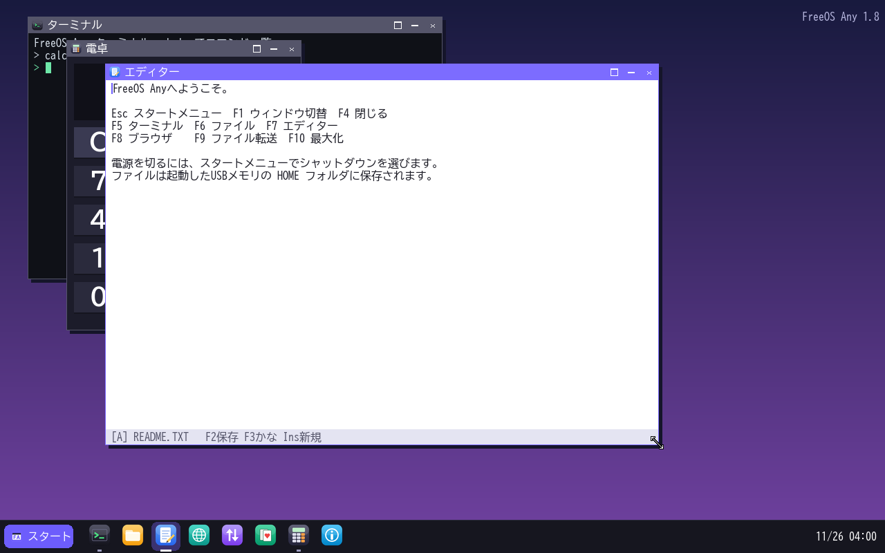
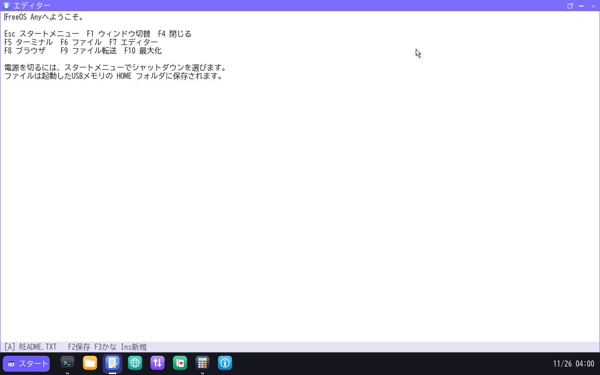
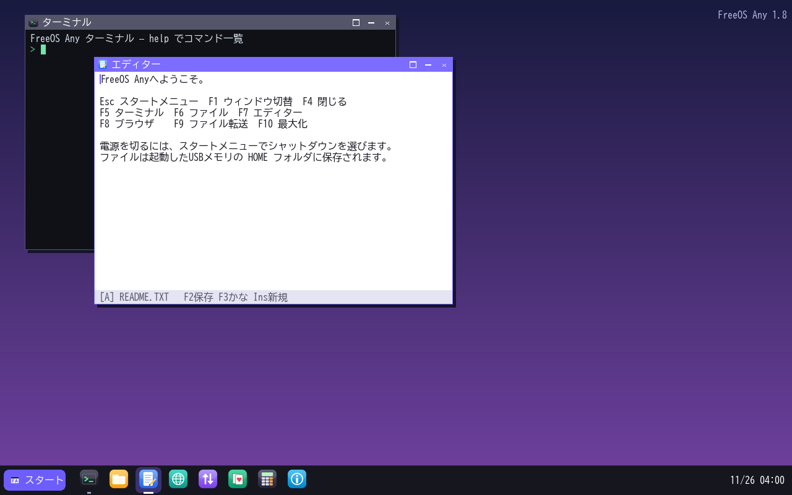

# FreeOS Any v1.8 — ウィンドウのサイズ変更と最大化

[← 開発の記録 (一覧)](../../HISTORY.md)

- 窓の左・右・下の縁と下の角をドラッグしてサイズ変更。縁ではカーソルが両矢印に
- 最大化ボタン、タイトルバーのダブルクリック、F10 で最大化 / 元に戻す
- 画面の版表示を 1.8 に

*右下の角をドラッグして大きく*

*最大化*

*デスクトップ*
