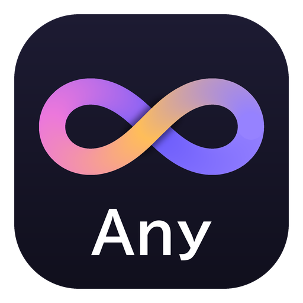
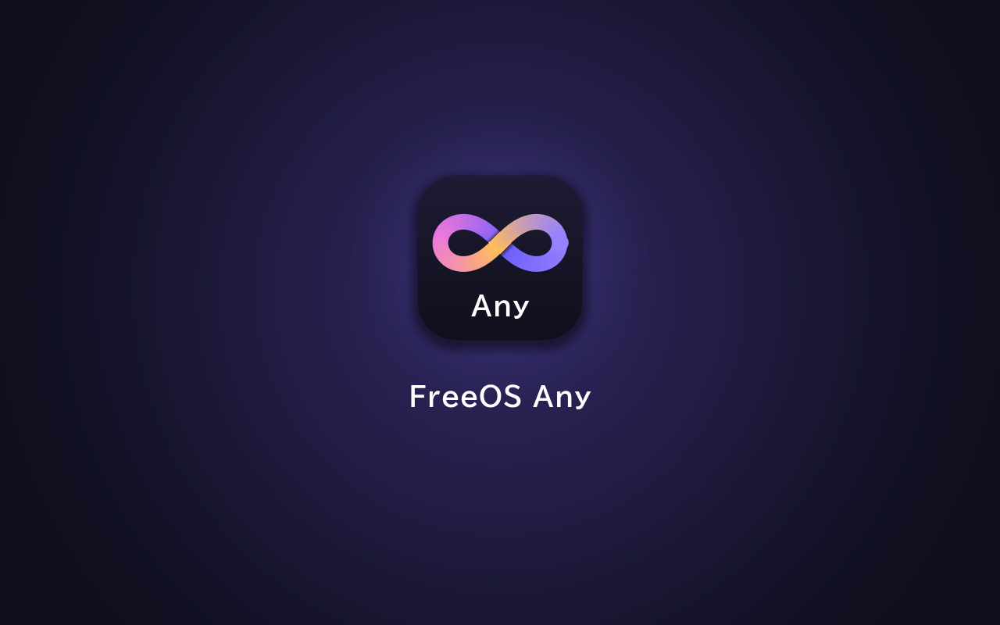
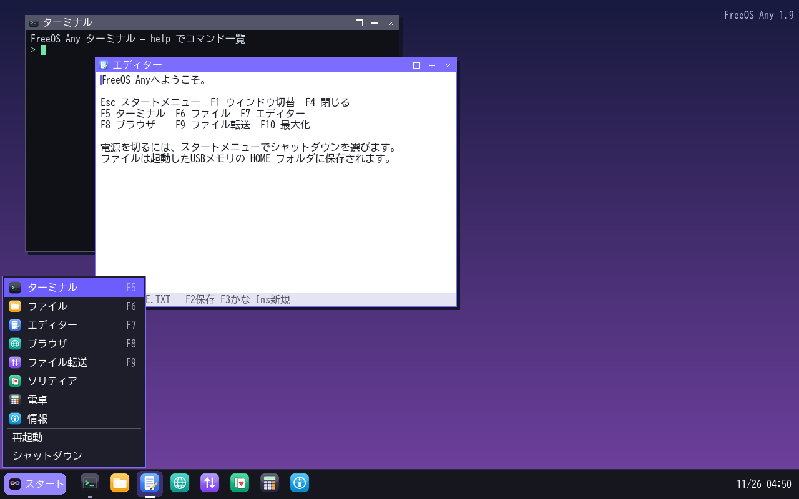

# FreeOS Any v1.9 — 新しいロゴ (∞ と Any)

[← 開発の記録 (一覧)](../../HISTORY.md)

- ロゴを「FA」から、夜空色の角丸に虹色の ∞ と「Any」に変更 (いつでも・どこでも動く OS)。6 案から選んだ
- 起動アニメーション: 角丸が現れ、∞ が右端から一筆で描かれ、交差点では手前の線が影を落として重なり、Any が浮かび、光が走る
- スタートボタンと Mac アプリ (dmg) のアイコンも同じロゴ。ロゴは `tools/logo.py` で描き、OS の中のアニメーションも同じ形と色

*新しいロゴ*

*起動アニメーション*

*スタートボタンもロゴに*
