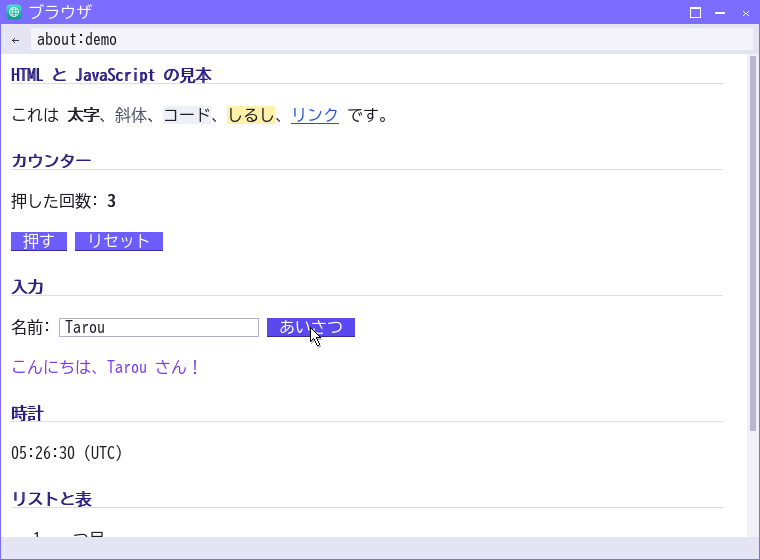
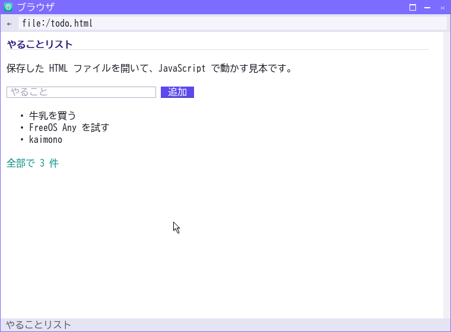
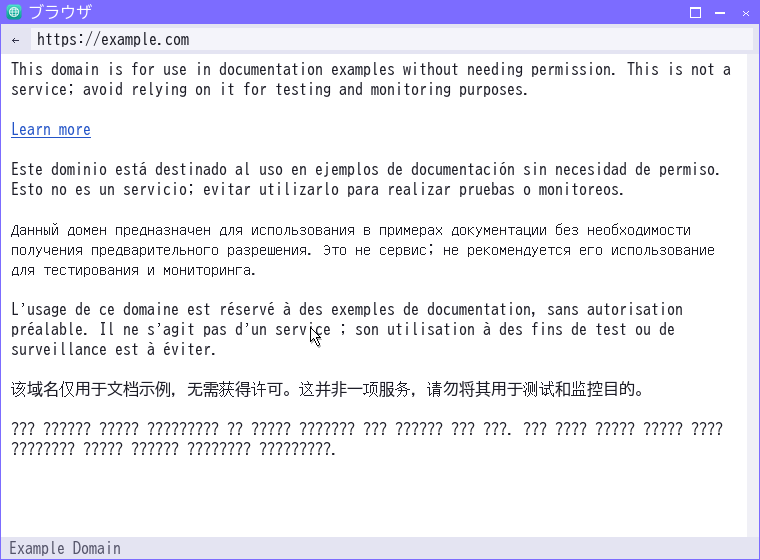

# FreeOS Any v2.0 — HTML と JavaScript のビューアー、スクロール、新しいカーソル

[← 開発の記録 (一覧)](../../HISTORY.md)

- ブラウザを作り直し: HTML を要素の木 (DOM) にして、見出し・強調・コード・リスト (入れ子)・表・フォーム・リンクをスタイル付きで表示。英語などは単語の切れ目で折り返す
- 小さな JavaScript エンジン (`src/js.c`、OS の中で動く解釈系) を追加。変数・関数・アロー関数・配列・オブジェクト・テンプレート文字列・try/catch・主な組み込み関数
- ページから DOM を操作できる: `getElementById` / `querySelector` / `textContent` / `innerHTML` / `insertAdjacentHTML` / `addEventListener` / `onclick` / `setTimeout` / `setInterval` / `alert` / `console.log` など
- HOME の `.html` をファイルアプリから開けるビューアーに。見本 `todo.html` をディスクに同梱。`about:demo` で見本ページ
- マウスのホイールでスクロール (ホイールのないアプリは矢印キーとして)。ブラウザにスクロールバー
- サイズ変更のカーソルを、なめらかな縁の両矢印 (横・縦・斜め 2 方向、影付き) に
- 文字の範囲を拡大 (ギリシャ文字・キリル文字・矢印・数学記号など)
- `tests/jstest.c` で JavaScript エンジンを Mac / Linux の上で直接試せる

*about:demo — ボタンで数が増え、入力した名前であいさつ、時計はタイマーで動く*

*ファイルアプリから開いた todo.html — JavaScript でリストに追加*

*example.com — ページのスクリプトが各国語の段落を足している*

*サイズ変更のカーソル (横・縦・斜め)*
