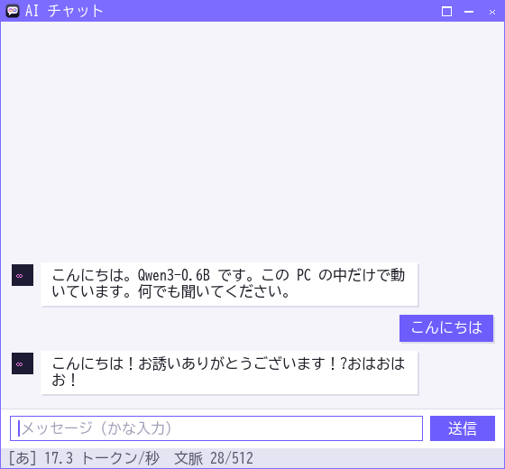

# FreeOS Any v2.1 — AI チャット (Qwen3-0.6B が OS の中で動く)

[← 開発の記録 (一覧)](../../HISTORY.md)

- Qwen3-0.6B と日本語で会話できる「AI チャット」を追加。OS の中だけで動き、通信しない
- 推論エンジン `src/llm.c` を新しく書いた (llm.asm を参考に C で)。重み 4 ビット・埋め込み 8 ビット、AVX2 で掛け算、トークナイザーは公式と同じ分け方
- モデルの変換 `tools/export_qwen3.py` (NumPy だけ)。モデル約 400MB、メモリ約 600MB
- エディターのローマ字かな入力をチャットでも使えるように。仮想マシンのメモリを 1.5GB に
- このMac (Core i7-5557U) の仮想マシンで 1 秒に約 17 トークン。NumPy で書いた見本の計算と結果が一致することを確認

*ローマ字で「こんにちは」と打って送ると、AI が日本語で返事 (17.3 トークン/秒)*
