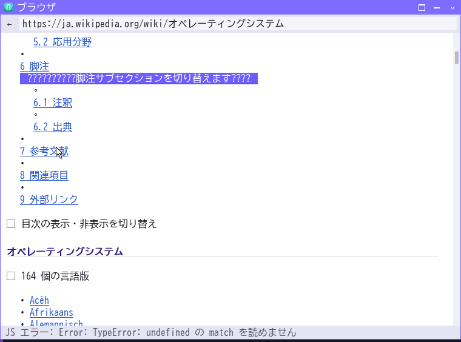
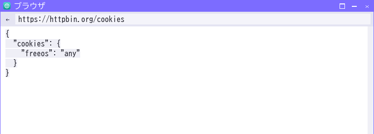
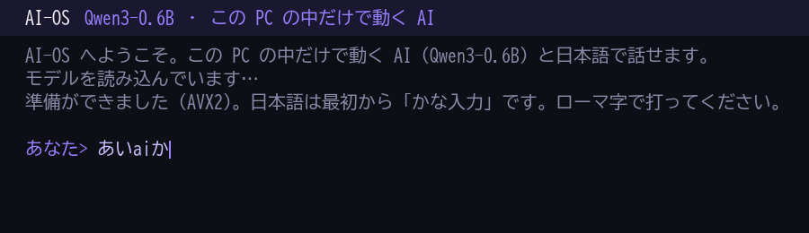

# FreeOS Any v2.2 — 「かな」「英数」キー、ブラウザの安定化、クッキー

[← 開発の記録 (一覧)](../../HISTORY.md)

- Mac の「かな」「英数」キーでかな入力を切り替えられるように。UEFI はこのキーを捨ててしまうので、仮想マシンのキーボード (virtio-keyboard) を自分で読む (`src/vkbd.c`)。実機では F3
- ブラウザが固まる・`self is not defined` などのおかしなエラーが出る問題を直した
  - JavaScript の字句解析が文字列ごとに残りのソース分のメモリを取っていた (2 乗で増える)。Wikipedia の起動スクリプトで 1GB → 3MB
  - メモリを使い切ると最初から上書きしていた (変数が壊れる)。今は安全に止めて「メモリが足りないので止めました」と出す
  - 要素の領域があふれると要素がつながって輪になり、表示が終わらなくなっていた
  - ループや関数を呼ぶたびに変数の置き場を作っていたのを、必要なときだけに。タイマーは 1 回に 4 つまで、エラーのタイマーは止める
- アドレス欄の日本語 URL を正しく表示
- クッキー: `Set-Cookie` を覚えて送る、`document.cookie`、期限、HttpOnly / Secure。`HOME\COOKIES.TXT` に保存して再起動しても残る
- `localStorage`・`matchMedia` など、よく使われるものの空の版

*Wikipedia: 重いページを送っても固まらない。日本語の URL も読める (正規表現は未対応なので、スクリプトは途中で止まる)*

*httpbin.org/cookies/set?freeos=any → 転送先にクッキーを送れている*

*「あい」→ 英数キー →「ai」→ かなキー →「か」*
