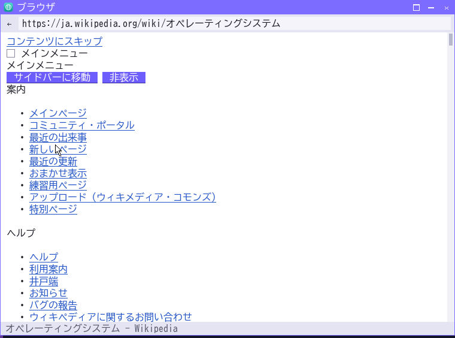
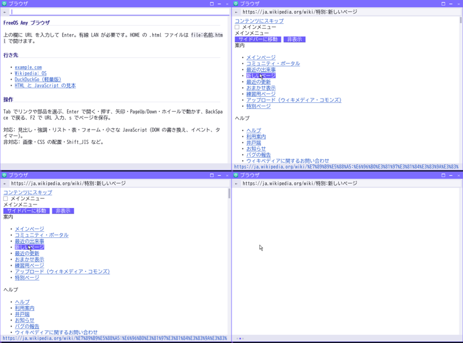

# FreeOS Any v2.3 — JavaScript の文法をひととおり、読み込み中も動く画面

[← 開発の記録 (一覧)](../../HISTORY.md)

- 正規表現エンジン (`src/regex.c`): `/…/flags`、`new RegExp`、`test` / `exec` / `match` / `matchAll` / `replace` (`$1` や関数) / `split` / `search`。文字クラス・`\d\w\s\b`・グループ (名前付きも)・選択・繰り返し (最短一致も)・先読み・後方参照・フラグ g i m s y
- class 構文 (`extends`、`super`、`static`、フィールド、getter / setter)、オブジェクトの getter / setter
- 分割代入をどこでも (変数・関数の引数・`for…of`・代入 `[a, b] = [b, a]`、入れ子・既定値・`...rest`)
- `?.` の途中打ち切り、ラベル付き `break` / `continue`
- `Map` / `Set`、`Promise` (`then` / `catch` / `finally` / `all` / `race`)、`async` / `await` (簡易)、`bind`
- 組み込みの追加: `Object.create` / `defineProperty` / `fromEntries` / `getPrototypeOf`、`Array` の `flat` / `flatMap` / `at` / `fill` / `entries`、`Math.atan2` など、`Number.isInteger` など、`Symbol` (簡易)
- ブラウザの読み込み中も OS が止まらない: 通信の待ち時間に画面・入力・ほかのアプリを動かす。読み込み中のブラウザは Esc で中止
- 1 回のクリックが 2 回分になり、開いたページの同じ位置のリンクまで押されていたのを直した (マウスの処理の二重読み)
- 日本語と英語がまざった行の折り返しを直した
- Wikipedia のスクリプトが最後まで動く

*Wikipedia のページ。スクリプトのエラーなし*

*直す前の記録: クリックが二重に扱われ、開いたページの同じ位置のリンク (新しいページ) に飛んでいた*
