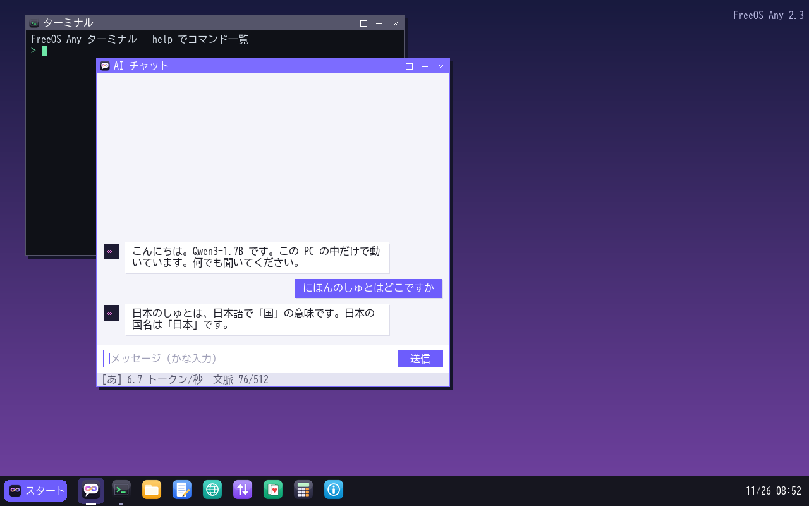

# FreeOS Any v2.4 — AI が入っている前提の OS に (Qwen3-1.7B)

[← 開発の記録 (一覧)](../../HISTORY.md)

- 標準のモデルを Qwen3-1.7B (重み 4 ビット、約 1.1GB) に。なければ 0.6B を使う
- 起動したら AI チャットが開く。タスクバーとスタートメニューの先頭は AI。F11 でどこからでも AI チャット
- ターミナルで `ai 質問` と打つと AI チャットに質問を送る
- 大きなファイルを 8MB ずつ読むように (1GB を超えるモデルを一度に読むと失敗していた)
- 仮想マシンのメモリを 2GB に
- 変換スクリプトが Hugging Face から重みを 1 つずつ取って変換できるように (`--url=`。元データ 4GB をディスクに置かずに済む)

**0.6B と 1.7B の比べ (Mac の上で直接):**

| 質問 | 0.6B | 1.7B |
|---|---|---|
| 日本の首都はどこですか？ | 日本の首都は、大阪です。 | 日本の首都は東京です。 |
| こんにちは | こんにちは！どういたい？ | こんにちは！いつものように、お元気ですか？ |
| 富士山の高さは？ | — | 約1690メートルです。(まちがい: 3776m) |

速さは 1.7B で 1 秒に約 6.5 語 (0.6B は約 17 語)。

*起動するとすぐ AI チャット。ひらがなだけで「にほんのしゅとはどこですか」と聞くと「しゅ」を読めない (漢字変換がないため)*
