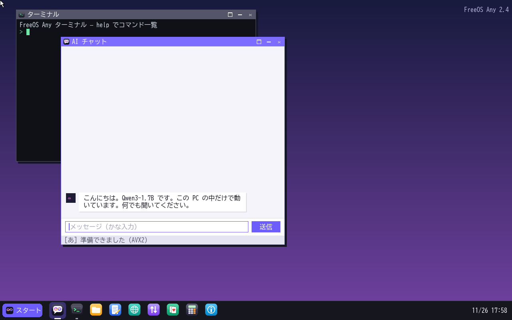

# FreeOS Any v2.5 — Mac アプリ版 (QEMU なしで動く)

[← 開発の記録 (一覧)](../../HISTORY.md)

- 仮想マシンを使わずに、Mac の普通のアプリとして動く版 (`make mac-app` → `build/mac/FreeOS Any.app`)
- OS 本体には手を入れず、UEFI ファームウェアの代わりを Mac 側で用意した (`mac/host_efi.c`): 画面、キー、マウス、時計、メモリ、乱数、ファイル
- 画面・入力は Cocoa (`mac/host_mac.m`)。キーは F キー・矢印・PageUp/Down・Esc・Delete・「かな」「英数」も。トラックパッドのスクロールも
- ファイルは `~/Library/Application Support/FreeOS Any/disk` のフォルダ (HOME もここ)
- 通信は macOS の URLSession (`mac/host_net.c`)。ブラウザ・クッキーはそのまま使える。ファイル転送 (サーバー) は使えない
- 時計は Mac の時刻 (仮想マシン版は UTC)
- アプリの中 (`Contents/Resources/AI`) か `FREEOS_MODEL_DIR` にモデルがあれば、データのフォルダからリンクする
- 音はまだ出ない (仮想マシン用・PC 用の音声ドライバしかないため)

*Mac アプリ版。起動するとすぐ AI チャット (Qwen3-1.7B) が準備できる。時計は日本時間*
